# Glance

A macOS overlay for calls and interviews. Glance listens to the other side of the call, picks out the questions, and shows you what to say, built from the conversation, your screen, and (for interviews) your own résumé. It works with Claude or any OpenAI-compatible model, and it can save meeting notes.

<p align="center">
  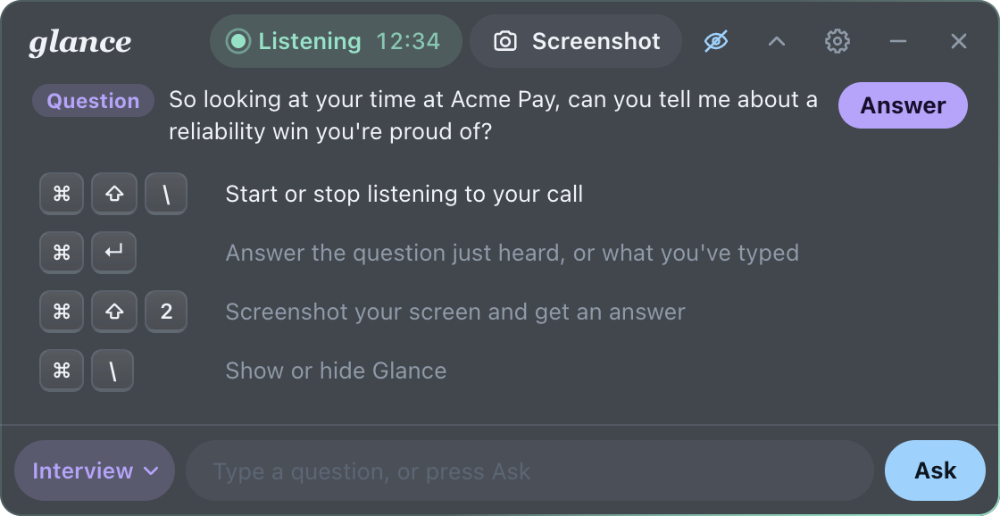
  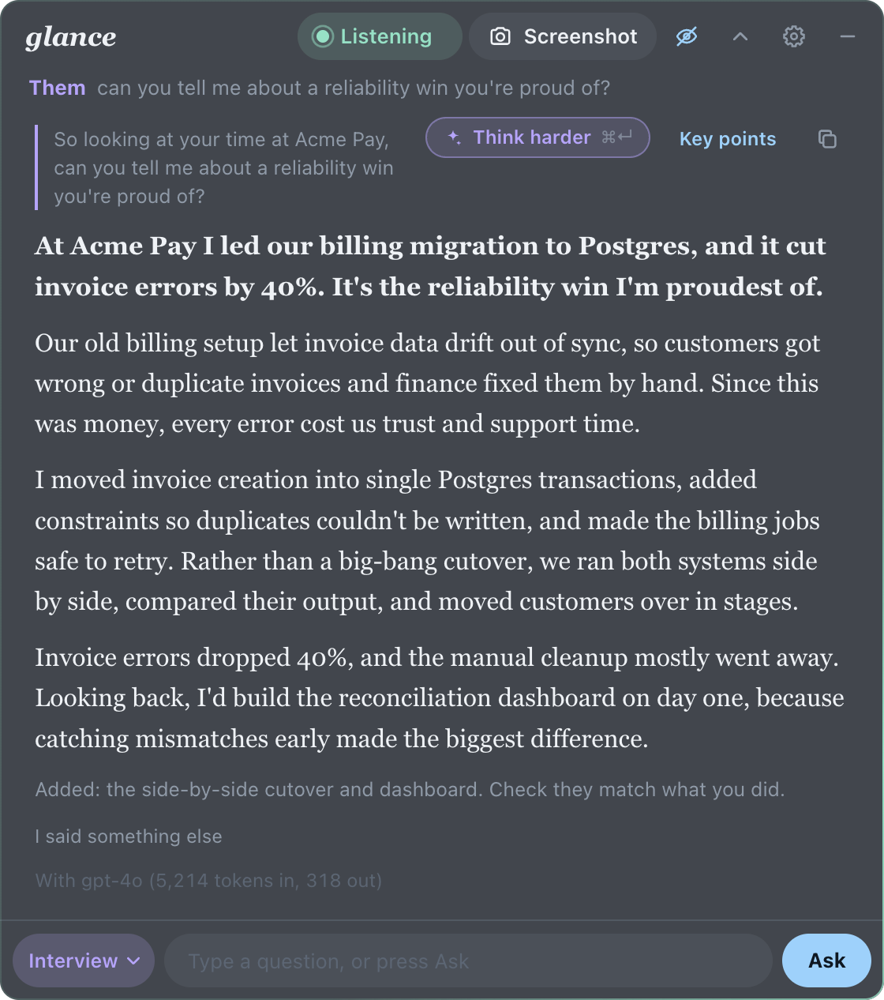
</p>

## Contents

- [Features](#features)
- [Screenshots](#screenshots)
- [Download](#download)
- [Requirements](#requirements)
- [Using Glance](#using-glance)
- [Interview mode](#interview-mode)
- [Settings](#settings)
- [AI providers](#ai-providers)
- [Choosing a model](#choosing-a-model)
- [Depth and Think harder](#depth-and-think-harder)
- [Troubleshooting](#troubleshooting)
- [Privacy and data](#privacy-and-data)
- [Screen sharing: what hiding does and doesn't do](#screen-sharing-what-hiding-does-and-doesnt-do)
- [Uninstall](#uninstall)
- [How it works](#how-it-works)
- [Build from source](#build-from-source)
- [Development](#development)

## Features

- **Hears the question.** Glance transcribes the Mac's audio (the other side of a Zoom, Meet or Teams call) on your machine with Whisper and detects questions as they're asked. A question split by pauses is joined back together, lead-in included ("So looking at your time at Acme Pay, can you tell me about…").
- **Answers in seconds.** Press **Answer** (⌘↵), or in Interview mode let Glance answer on its own once the interviewer finishes. If you press Answer while they're still talking, Glance waits for the rest of the question.
- **Fast when it can be, careful when it counts.** Everyday spoken questions start in about a second; design, coding, estimates, typed questions and screenshots think first when Depth is Balanced; **Think harder** re-answers any quick answer more carefully.
- **Sounds like you.** Interview mode answers in the first person, as natural speech, using your résumé as a case study: real roles, projects and numbers, no placeholders. A short note lists anything Glance added so you can check it.
- **Glanceable.** Each long interview answer carries 3 or 4 key phrases. Switch an answer to **Key points** to see just the opening line and the phrases while you talk.
- **Keeps up with you.** If you said something different from the suggestion, press **I said something else** and type a few words; follow-ups build on what you actually said.
- **Sees your screen.** Screenshot a coding problem, an error or a shared doc and get an answer (⌘⇧2).
- **Any model.** Anthropic (Opus, Sonnet, Haiku) or any OpenAI-compatible API: OpenAI, Google Gemini, OpenRouter, Groq, Mistral, or a local Ollama or LM Studio.
- **Meeting notes.** Save a Markdown summary with decisions, action items, the transcript and every question asked.
- **Stays out of the way.** A small always-on-top panel that sizes itself to its content, can hide from screen sharing, and follows macOS light and dark mode, or you can set it to light or dark in **Settings › General › Appearance**.

## Screenshots

| | |
| --- | --- |
| 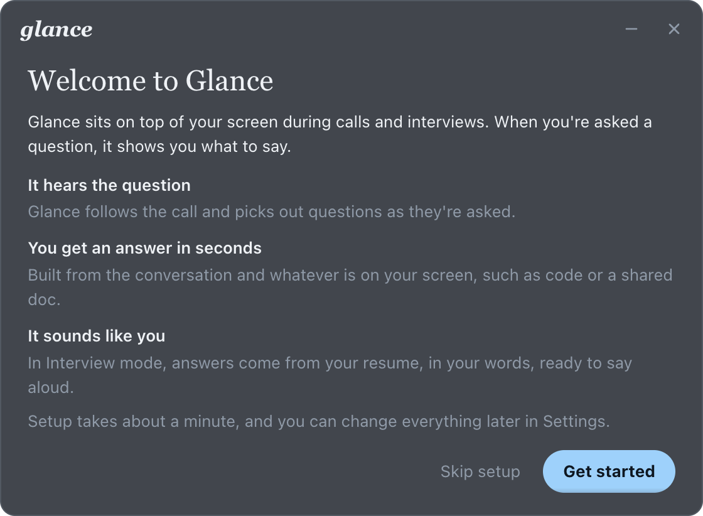 | 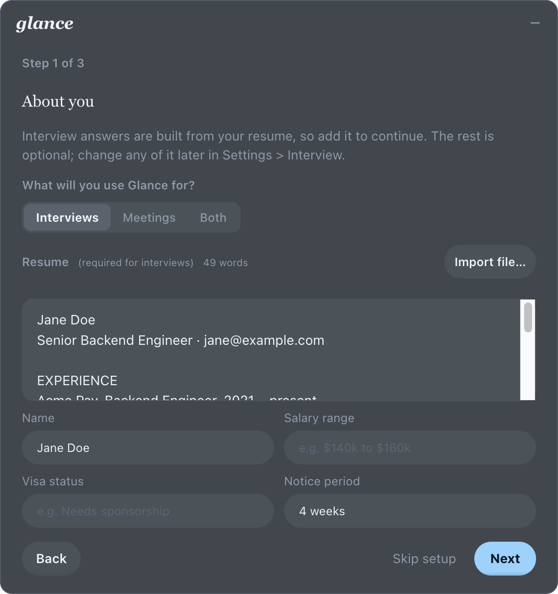 |
| **First launch.** A short setup, then the speech model download. | **About you.** Your résumé and details, imported or pasted. |
| 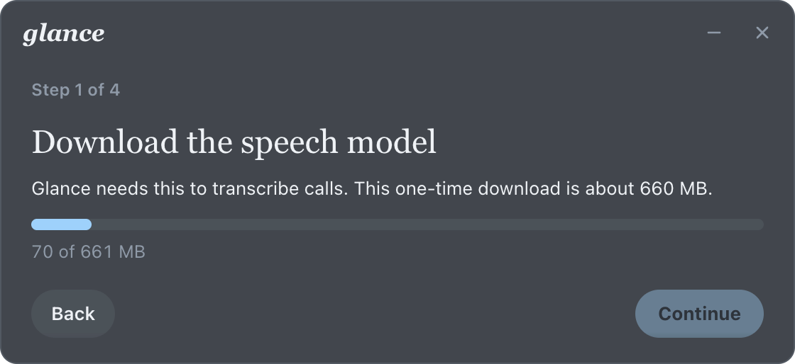 | 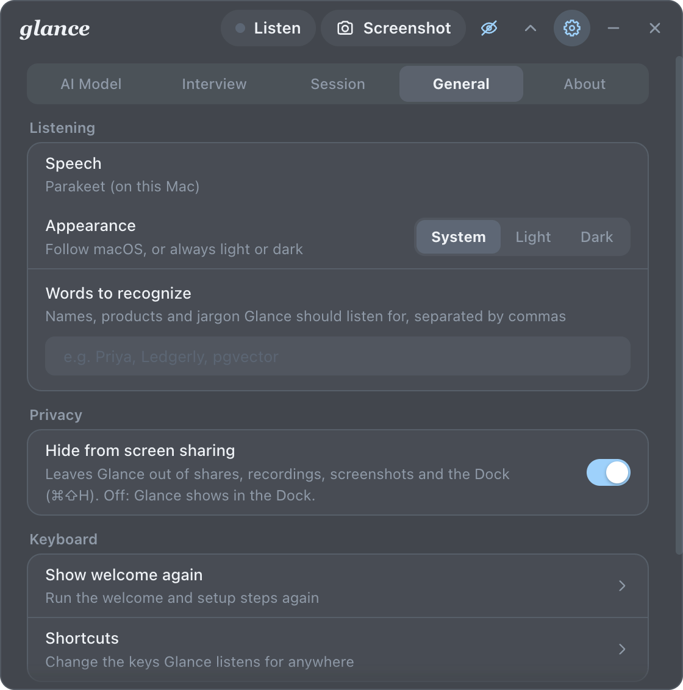 |
| **Speech model.** Downloaded once on first launch. | **Settings › General.** Transcription, appearance, shortcuts. |
| 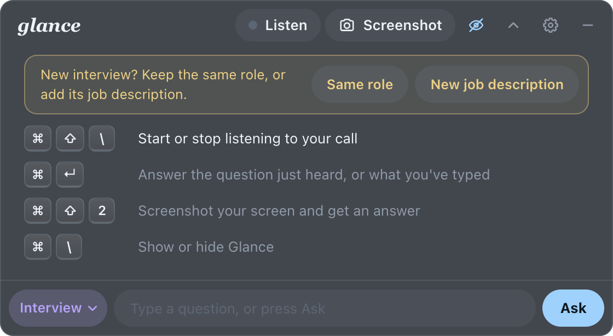 | 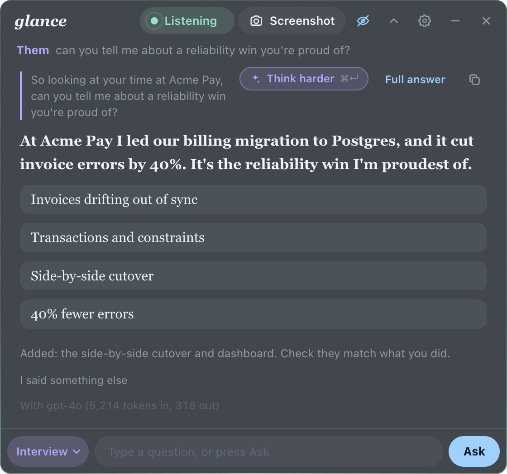 |
| **Each new interview.** Keep the same role or add its job description. | **Key points.** The opening line and the beats of the answer. |
| 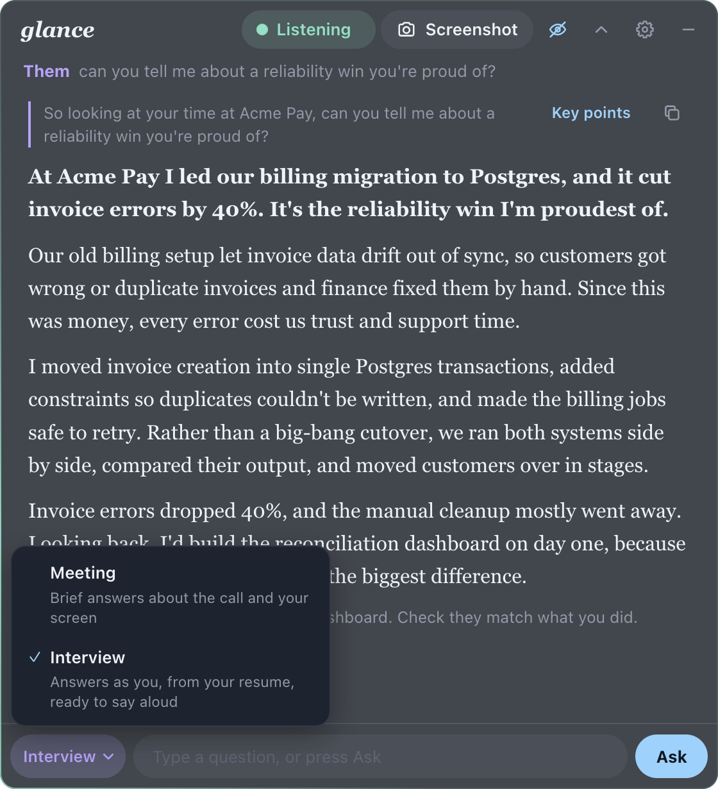 | 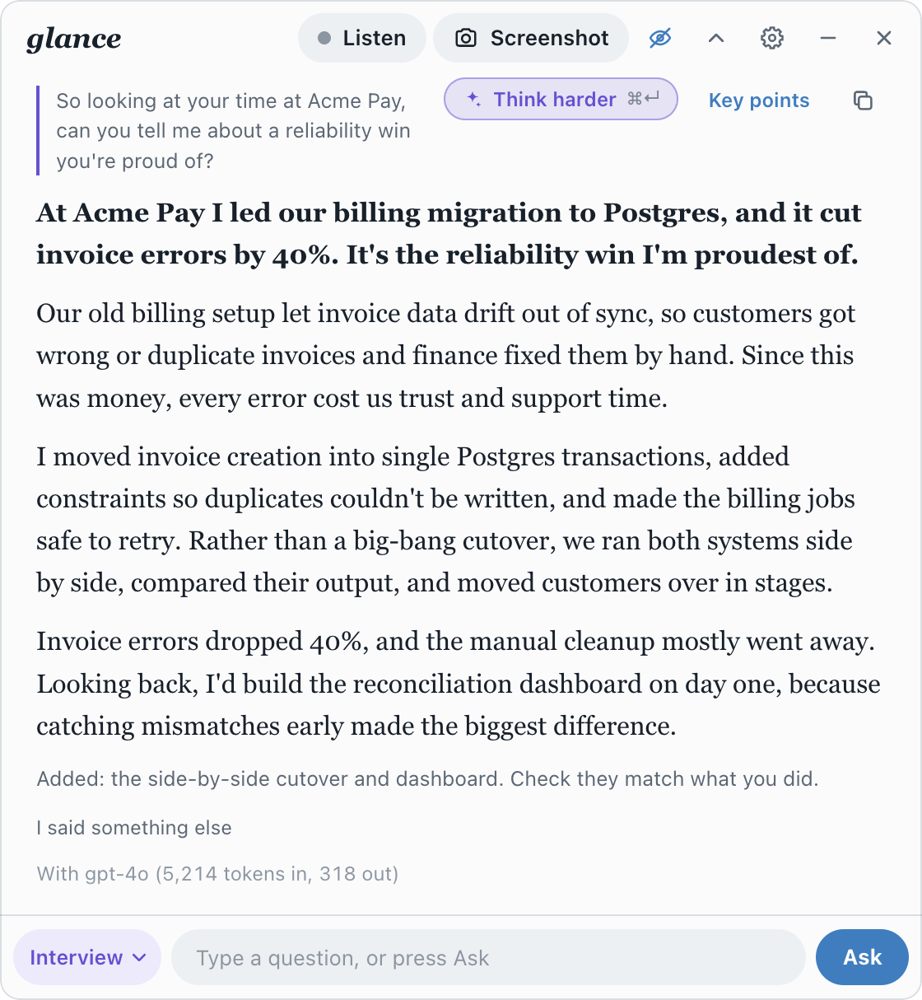 |
| **Answer mode.** Meeting or Interview, one click away. | **Light mode.** Follows macOS, or set it in Settings › General › Appearance. |
| 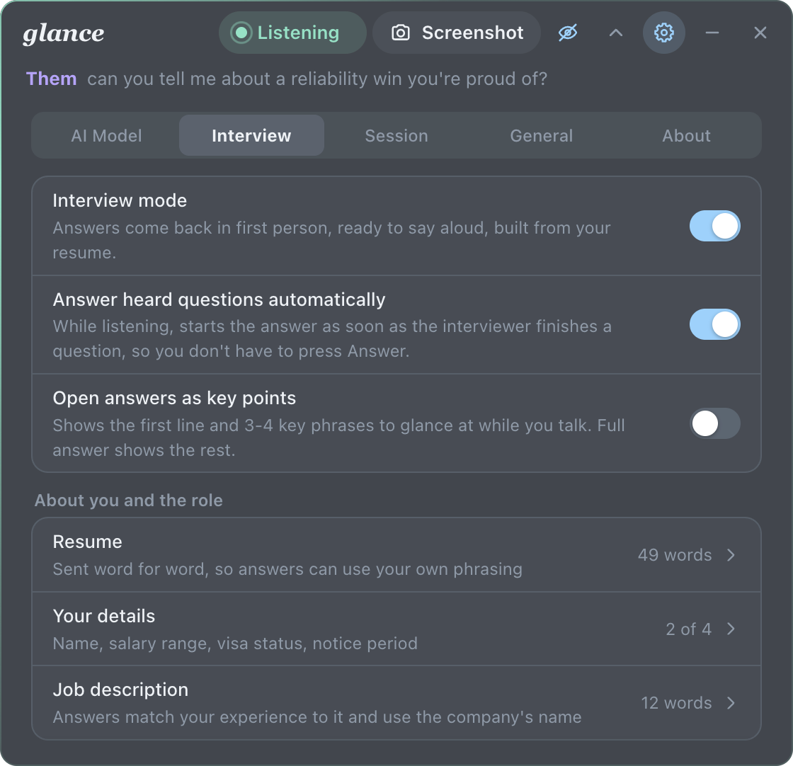 | 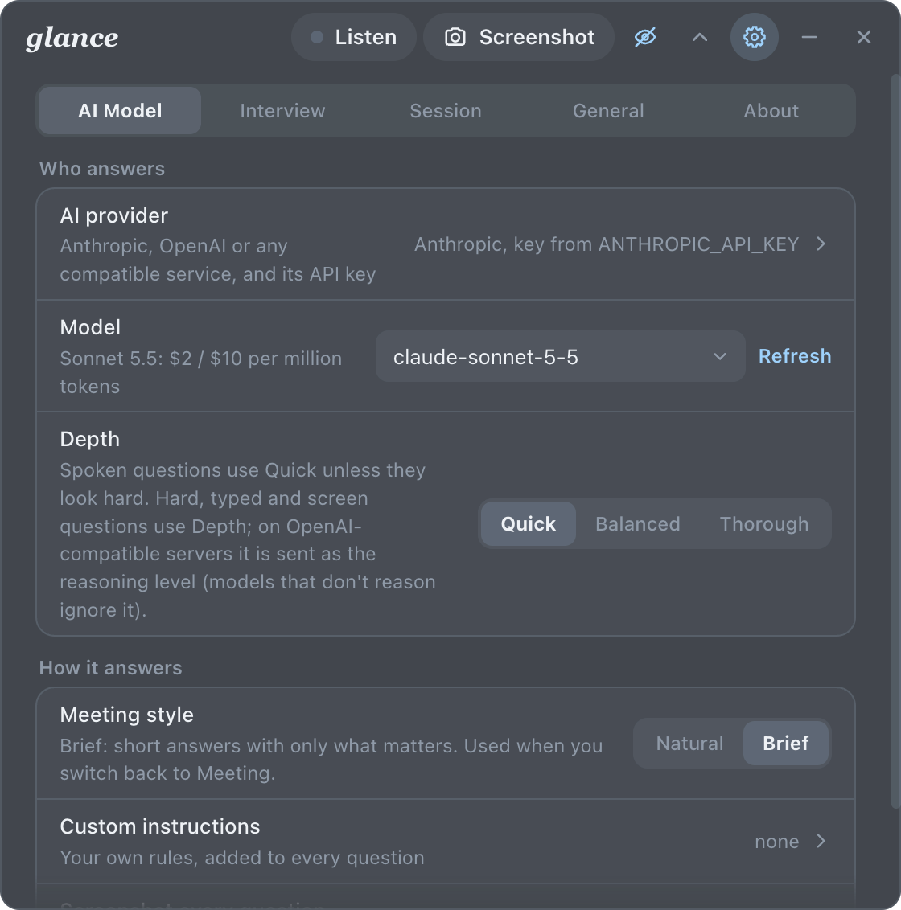 |
| **Settings › Interview.** Interview mode, auto-answer, key points, résumé. | **Settings › Answers.** Provider, model, depth and style. |

The screenshots use a made-up profile (Jane Doe at Acme Pay) and are regenerated with `node scripts/screenshots.mjs`.

## Download

> **Glance downloads its speech model the first time it opens.** You need an internet connection for that first launch.

- The DMG is about 95 MB.
- The model (small.en, about 490 MB) comes from [Hugging Face's whisper.cpp repo](https://huggingface.co/ggerganov/whisper.cpp) into `~/Library/Application Support/Glance/models`.
- Setup starts with a required **Download the speech model** step: **Continue** and **Skip setup** stay disabled until it finishes.
- The download resumes after a dropped connection, is checked against its SHA-256, and offers **Try again** if it keeps failing.
- If the model is already installed, nothing downloads; people updating from an earlier version see only this step, once.

1. Download the latest **Glance-…-arm64.dmg** from [Releases](https://github.com/Jchinonso/glance/releases) (Apple Silicon Macs).
2. Open it and drag **Glance** onto **Applications**.
3. Open Glance from Applications. The app isn't notarized by Apple, so the first time macOS says it can't verify the developer: **right-click Glance › Open › Open**, or go to **System Settings › Privacy & Security** and click **Open Anyway**. After that it opens normally.
4. Follow the setup, and grant **Screen & System Audio Recording** when macOS asks (then quit and reopen Glance).

Nothing else to install: the speech engine (whisper.cpp, with GPU acceleration through Metal) is inside the app. Version 1.0.0 also needed `brew install whisper-cpp`; 1.1.0 and later don't.

## Requirements

- A Mac with Apple Silicon (the build targets `darwin-arm64`).
- An internet connection on first launch, for the speech model download (about 490 MB).
- To build from source: [Homebrew](https://brew.sh) and Node.js 20 or later. The downloaded app needs neither.
- An API key for Anthropic or an OpenAI-compatible service, or a local model server (Ollama, LM Studio) that needs no key.

## Using Glance

### First launch

On first launch Glance walks you through setup: the speech model download, an API key (only if none is saved), what you'll use it for, your résumé and details, and, for interviews, the job description. For interviews the résumé is required, since answers are built from it; for meetings it's optional. You can change everything later in Settings.

macOS asks for **Screen & System Audio Recording** permission the first time you listen or take a screenshot. Allow it, then reopen Glance once: macOS only sends audio to an app after it reopens. macOS remembers the permission, so this happens only once.

### Listening and answering

1. When the call starts, press **Listen** (⌘⇧\\). The timer shows how long Glance has been listening.
2. When the other side asks a question, it appears under the bar with a **Question** tag.
3. Press **Answer** (⌘↵), or in Interview mode wait a moment: Glance answers on its own once they finish.
4. Type your own question in the box at any time, or take a screenshot (⌘⇧2) to ask about what's on screen.

| Default shortcut | Action |
| --- | --- |
| ⌘⇧\\ | Start or stop listening |
| ⌘↵ | Answer the question just heard, or what you've typed; with nothing new heard, Think harder on the last quick answer |
| ⌘⇧2 | Screenshot and answer |
| ⌘⇧1 | Add a screenshot without asking (collect several first) |
| ⌘\\ | Show or hide Glance |
| ⌘⇧H | Hide from screen sharing (on or off) |
| ⌘ + arrows | Move the window |

Shortcuts work from any app and can be changed in **Settings › General › Shortcuts**. The menu bar icon shows or hides the window; right-click it for more. Esc closes whatever panel is open.

Answers stay at the top while they stream in. Older answers stay in the pager (‹ 1 of 3 ›). An answer cut short by **Stop**, a new question or a typed one is marked "Stopped before the end". Each answer shows its estimated cost (in dollars for the Anthropic models Glance has prices for, otherwise in tokens).

### Notes

**Settings › Session › Save notes** writes a Markdown file to `~/Documents/Glance/` with a summary, decisions, action items, the transcript and every question and answer.

## Interview mode

Glance starts in Interview mode. Switch with the mode menu beside the question box (or **Settings › Interview › Interview mode**); **Meeting** gives Brief or Natural answers about the call and your screen. Auto-answer and the interview prompts below work only in Interview mode.

- **Your résumé and the job description.** Import a PDF, Word, RTF or text file, or paste. Both are sent word for word with every question (up to 20,000 characters each), never compressed, so answers can use your own phrasing. Check imported PDF text: PDFs can merge lines or drop bullets.
- **Your details.** Name, salary expectation, visa status and notice period, used when an interviewer asks.
- **Answers.** First person, spoken prose: a bold opening line, two to four short paragraphs, then an optional note. Stories come from your real roles and projects; added specifics stay modest and are listed in the note. Glance answers honestly when you lack an experience, and never volunteers salary, visa or weaknesses unless asked. Technical, behavioral, system design, coding, HR, case and product questions each get a fitting shape.
- **Auto-answer.** While listening, Glance answers when the interviewer finishes their turn (goes quiet). Obvious questions are recognized instantly, without a question mark, from how sentences start ("can you", "walk me through", "let's talk about", "help me understand", "what if", and others), including a question in the middle of a line or after an announcement ("My first question for you is, tell me about yourself"). Anything else they say in a turn of 5 words or more is checked by your model, which skips turns with nothing to answer (greetings, introductions, explaining the format, small talk) and answers the rest, so implied questions ("I'm keen to hear about the project you're proudest of") are answered too. That check costs one request per interviewer turn that isn't an obvious question; it reuses the cached prompt, and a skipped turn stops after a few tokens and shows nothing. A follow-up comment from the interviewer within 10 seconds doesn't cancel the question. Auto-answer waits only while you're typing (the last 5 s), while an answer you asked for is still streaming, or while a form or Settings is open (the transcript view doesn't hold it). It never interrupts an answer you asked for or a question you're typing, and if the interviewer carries on after a long pause, the whole question is answered again. Turn it off in **Settings › Interview › Answer heard questions automatically**.
- **Key points.** **Key points** on an answer shows the opening line and 3 or 4 phrases; **Full answer** shows the rest. To open every answer that way, turn on **Settings › Interview › Open answers as key points**.
- **I said something else.** Type what you actually said under an answer; later questions build on that, not the suggestion.
- **New interview?** When you start listening in Interview mode, Glance asks whether it's the same role or a new job description (again after 30 minutes, or after Clear session). If no résumé is saved, it asks for that first.

## Settings

The gear opens four tabs (**Answers**, **Interview**, **Session**, **General**). Panels opened from Settings have a Back button that returns to the same tab.

- **Answers:** AI provider and key, model (listed from the provider, searchable, and any model ID can be typed), Depth (Quick, Balanced, Thorough), meeting style (Natural or Brief), custom instructions (compressed automatically when saved), and Screenshot every question (whether typed questions include a screenshot).
- **Interview:** Interview mode, auto-answer, key points, résumé, your details, job description, and a warning when Glance would show in a screen share.
- **Session:** spending so far, the transcript, Save notes, Clear session.
- **General:** Transcription (Accurate or Fast), Appearance (System, Light, Dark), words to recognize (names and terms the transcriber should expect), hide from screen sharing, shortcuts, show the welcome again, and Delete all Glance data.

**Transcription.** Under **Settings › General › Transcription**, **Accurate** (the default) uses small.en (488 MB): much better with technical terms, accents, noise and quiet speakers, and still faster than real time on Apple Silicon. **Fast** uses base.en (148 MB), about twice as quick per piece but makes more mistakes. It is downloaded only the first time Fast is picked; Accurate is used until it's ready. Accurate is recommended for interviews: a misheard question can't be answered well.

**Depth.** **Settings › Answers › Depth** (Quick, Balanced, Thorough) sets how long the model may think on questions that need it. Everyday spoken questions stay fast either way. See [Depth and Think harder](#depth-and-think-harder) for which questions use it, and [Choosing a model](#choosing-a-model) for recommended settings.

## AI providers

Choose a provider in **Settings › Answers › AI provider**, or in setup. The two cards open the same form: **OpenAI-compatible** for any server that speaks the OpenAI API (hosted or on your network), or **Anthropic** for Claude through your own key. OpenAI-compatible has a **Server address**, a **Model** box and an **API key**; Anthropic has just the model and key.

Models are listed from the provider itself: Anthropic's Models API, or the server's `/models` endpoint for OpenAI-compatible services. The **Model** box filters as you type (OpenRouter lists hundreds), and you can type any model ID the list doesn't show. Models that can't answer a chat (embeddings, speech, image and moderation models) and OpenRouter's delayed `:batch` versions are left out. In **Settings › Answers › Model**, the same list is a dropdown with a **Refresh** link, and the line under it shows the price per million tokens for Opus 5.5, Sonnet 5.5 and Haiku 5.5. **Depth** only appears for models that support it, so it's hidden for older Claude models such as Haiku 4.5.

**Test connection** sends one tiny request with the values currently in the form, even before you save them, and reports how long the model took to reply. Use it to check a new key, model or server address before relying on it.

| Provider | Setup | Cost shown |
| --- | --- | --- |
| Anthropic | API key from [console.anthropic.com](https://console.anthropic.com) | Dollars for Opus 5.5, Sonnet 5.5 and Haiku 5.5; tokens for other Claude models |
| OpenAI, Gemini, OpenRouter, Groq, Mistral… | Server address, model and API key | Tokens only |
| Ollama or LM Studio (local) | Server address such as `http://localhost:11434/v1` and model; no key | Tokens only |

On Anthropic, Glance caches its instructions between questions (repeats cost a tenth), retries without the server-side refusal fallback if your account doesn't have it, and uses Opus to compress custom instructions. On OpenRouter, Claude models cache the résumé, job description and instructions for an hour the same way, and Gemini models for 5 minutes (other models there cache automatically). Depth's thinking control is Anthropic-specific (OpenAI-compatible servers get it as a reasoning level). Text-only models can't read screenshots; Glance says so and suggests turning screenshots off.

## Choosing a model

Glance works with any model your provider lists, but for live calls three things matter: how soon the first word appears, whether the model reads screenshots, and how well it reasons through code and design. These are the setups we recommend.

On **Anthropic's own API**:

| Interview | Model | Depth | Screenshots |
| --- | --- | --- | --- |
| Behavioral, HR or mixed | **Haiku 5.5** | Quick | Rarely needed |
| Technical (coding, debugging, system design) | **Sonnet 5.5** | Balanced | ⌘⇧2 when a problem is on screen |
| Hardest technical rounds | **Opus 5.5** | Balanced | ⌘⇧2 when a problem is on screen |
| Lowest cost | **Haiku 5.5** | Quick | Rarely needed |

The same setups on **OpenRouter** (one key for many companies' models), with a cheaper alternative for each:

| Interview | OpenRouter model | Cheaper alternative | Depth | Screenshots |
| --- | --- | --- | --- | --- |
| Behavioral, HR or mixed | `anthropic/claude-haiku-5.5` | `qwen/qwen3.7-flash` (untested) | Quick | Rarely needed |
| Technical (coding, debugging, system design) | `anthropic/claude-sonnet-5.5` | `google/gemini-3.8-flash` | Balanced | ⌘⇧2 when a problem is on screen |
| Hardest technical rounds | `anthropic/claude-opus-5.5` | `openai/gpt-5.4` (slower) | Balanced | ⌘⇧2 when a problem is on screen |
| Lowest cost | `anthropic/claude-haiku-5.5` | `qwen/qwen3.7-flash` (untested) | Quick | Rarely needed |

To set up OpenRouter: in **Settings › Answers › AI provider** choose **OpenAI-compatible**, type `openrouter.ai` as the server address (Glance fills in `https://openrouter.ai/api/v1`), pick the model from the list, paste your OpenRouter key from [openrouter.ai/keys](https://openrouter.ai/keys), and press **Test connection**.

For every interview, keep **Settings › General › Transcription** on **Accurate** and turn on **Interview mode** with auto-answer. In a coding or design round, press **Screenshot** (⌘⇧2) when the problem appears: the answer uses the screen and what was just said. A spoken question gets a screenshot by itself only when it mentions the screen ("look at this function"), and **Settings › Answers › Screenshot every question** only adds one to questions you type.

**Anthropic or OpenRouter.** Both cache your résumé, job description and instructions and warm the cache when you press Listen (on OpenRouter for Claude models for an hour and Gemini models for 5 minutes; other models there cache automatically). For Claude models, Anthropic's own API (a key from [console.anthropic.com](https://console.anthropic.com)) is still the best fit: Glance controls thinking exactly, retries a refused request on another model (Opus and Sonnet), and shows costs in dollars. OpenRouter gives one key for hundreds of models from many companies, sends Depth as each model's reasoning level, and shows tokens rather than dollars.

On OpenRouter, pick a model that reads images if you use screenshots. Some good choices, with OpenRouter's prices in dollars per million tokens as of November 2026 (they change, so check openrouter.ai):

| OpenRouter model | Input | Output | Notes |
| --- | --- | --- | --- |
| `anthropic/claude-haiku-5.5` | 0.10 | 0.50 | Cheapest good all-rounder, fast |
| `openai/gpt-5.4-mini` | 0.75 | 4.50 | Mid-priced |
| `google/gemini-3.8-flash` | 0.83 | 4.12 | Strong at screenshots and code for the price |
| `anthropic/claude-sonnet-5.5` | 2.00 | 10.00 | Best balance for technical rounds |
| `openai/gpt-5.4` | 2.50 | 15.00 | Strong, but writes slowly through OpenRouter (about 45 tokens a second in our tests) |
| `anthropic/claude-opus-5.5` | 4.00 | 20.00 | Most capable, for the hardest problems |

A typical answer sends about 8,000 tokens (instructions, résumé, job description and transcript, mostly cached after the first question) and gets about 400 back, so an answer costs roughly a tenth of a cent on Haiku 5.5 and about two cents on Sonnet 5.5.

**Measured speed** (time from asking to the first word, on a typical connection):

| Model | Spoken question (Quick) | Question that thinks (Balanced) |
| --- | --- | --- |
| Haiku 5.5 | about 1 s | about 6 to 9 s |
| Sonnet 5.5 | about 2 s | several seconds more |
| `openai/gpt-5.4` on OpenRouter | about 1.5 to 2 s, full answer about 8 s | about 14 s |

## Depth and Think harder

Depth never changes on its own. For each question Glance decides whether to answer at **Quick** (no thinking, fastest) or at **your Depth setting**:

| Question | Level used |
| --- | --- |
| Spoken, everyday ("tell me about yourself", "what is the event loop") | Quick |
| Spoken story ("tell me about a time you…") | Quick |
| Spoken and hard: designing a system, writing code, algorithms, complexity, estimates, scale, trade-offs, debugging, edge cases | Your Depth |
| Typed, a screenshot, or a spoken question about the screen | Your Depth |
| **Think harder** | Your Depth, but at least Balanced |

So Depth only decides how hard Glance thinks when a question needs it:

- **Quick:** nothing thinks unless you press Think harder. Everything starts in about a second, but hard questions are answered without working through them, which is fine for concepts and most design talk and riskier for algorithm puzzles, complexity, estimates and tricky edge cases.
- **Balanced** (recommended for technical interviews): hard, typed and screenshot questions think for a few seconds first; everyday spoken questions stay fast.
- **Thorough:** thinks longest. Worth it only for very hard problems.

**Think harder.** A spoken answer given at Quick has a **✦ Think harder** button at the top, next to Key points. Press it, or the Answer shortcut (⌘↵) when nothing new has been heard, and Glance answers the same question again with thinking, at Balanced or your Depth if higher. While it works the answer says "Thinking it through…", and the quick answer stays on the previous page. With a new question already heard, ⌘↵ answers that question instead.

**On OpenAI-compatible servers** Depth is sent as the reasoning level (`reasoning_effort`, or `reasoning.effort` on OpenRouter). Quick tries `none`, then `minimal`, then `low`, so each model gets its fastest setting, and models that don't reason ignore it. Glance remembers what each model accepts.

## Troubleshooting

- **"Glance can't see your screen."** Turn Glance on in System Settings › Privacy & Security › Screen & System Audio Recording, then quit and reopen it.
- **Listening shows nothing.** macOS sends an app system audio only after it reopens following the permission prompt; until then Glance hears silence, and after 15 seconds of it (once each time Glance opens, and not once sound has come through) it says so with a **Reopen Glance** button. If that doesn't help, check Glance is on under Screen & System Audio Recording and under **System Audio Recording Only**. Building from source: make sure `brew install whisper-cpp` ran before `npm run package`.
- **Answers are slow.** Everyday spoken questions always answer at Quick; if hard, typed or screenshot questions feel slow, set Settings › Answers › Depth to **Quick** and use **Think harder** only when an answer looks shaky. A faster model helps most: Haiku 5.5 starts in about a second (see [Choosing a model](#choosing-a-model)). Keep Settings › General › Transcription on Accurate unless the log shows transcription is the bottleneck; see Logs below.
- **A question gets no answer.** Auto-answer waits while you're typing, while an answer you asked for is still streaming, or while a form or Settings is open; a turn the rules don't recognize is checked by your model, which may judge it has nothing to answer: press **Answer** (⌘↵) to answer the latest one, and check the log for `turn check … result=none` after the heard line.
- **The speech model download fails.** Check the connection, then press **Try again** in setup (or Settings › General › Transcription for the Fast model). It resumes from where it stopped. Glance retries 3 times on its own before showing **Try again**.
- **Names or jargon are misheard.** Add them under Settings › General › Words to recognize. Accurate transcription (the default) uses the larger model.
- **A shortcut doesn't work.** Another app may own it; Glance says which at startup. Change it in Settings › General › Shortcuts.
- **Answers fail.** The message says why (key rejected, out of credit, model not found, rate limited). Check Settings › Answers › AI provider.
- **Logs.** `~/Library/Logs/Glance/glance.log` records what happens in a session. It stays on your Mac and includes the first 80 characters of what was said.
  - **What it records:** each heard line (speech length, `transcribeMs`, `waitMs`, `queued`, and whether it came via the server or the CLI), question detected / extended / replaced / dropped, auto-answer fired, turn check sent and its result (`result=none` or `result=answer`), each answer (`sinceSpeechEndMs`, model, `effort` used and your `depth` setting, `hard` and `deep` for hard questions and Think harder, first-token ms, total ms, `cacheRead` and `cacheWrite`), and `prewarm` when Listen warms the cache.
  - **How to read it:**
    - Slow transcription: a long `transcribeMs` or a growing `queued` count means transcription is the bottleneck.
    - Slow first token: a long first token points to Depth or the model; `effort=medium` or `high` means that answer thought first.
    - Cache: `cacheRead` above 0 means the résumé and instructions came from the cache.
    - Missed question: a heard line with no "question detected" after it.

## Privacy and data

- **Audio stays on your Mac.** Transcription runs locally with Whisper. Only text (and screenshots you take or allow) is sent to your AI provider.
- **The microphone is never recorded.** Glance hears only the Mac's audio, the other side of the call.
- **Keys** are stored in the macOS login keychain, not in files.
- **Where things live.** Settings are in `~/Library/Application Support/Glance/config.json`, the downloaded **speech model** in `~/Library/Application Support/Glance/models`, **logs** in `~/Library/Logs/Glance/glance.log`, **notes** in `~/Documents/Glance/`.
- Glance treats the transcript, screen text, résumé and job description as data, not instructions.
- **Settings › General › Delete all Glance data** removes all of the above in one step (see [Uninstall](#uninstall)).

## Screen sharing: what hiding does and doesn't do

With **Hide from screen sharing** on (the eye icon, ⌘⇧H), macOS leaves Glance out of screen captures and recordings, including Zoom, Meet and Teams screen shares. Glance keeps itself out of its own screenshots either way.

It does **not** hide Glance from a camera pointed at your screen, from interview tools that lock down the browser or watch the camera, or from an interviewer noticing you reading. Many companies don't allow outside help during interviews; check the rules before you use it.

## Uninstall

Dragging an app to the Trash doesn't tell it anything, so on macOS an app's keys and settings stay behind unless you remove them. Glance keeps your API keys and résumé, so remove them first:

1. Open Glance, then **Settings › General › Delete all Glance data**. It lists what it removes and asks you to confirm:
   - your API keys, from the macOS keychain;
   - settings, résumé, job description and your details (`~/Library/Application Support/Glance`);
   - the downloaded speech models (`~/Library/Application Support/Glance/models`);
   - logs (`~/Library/Logs/Glance`);
   - optionally, your saved meeting notes (`~/Documents/Glance`), moved to the Trash.

   Glance then quits.
2. Drag **Glance** from Applications to the Trash.
3. Optional: remove Glance from **System Settings › Privacy & Security › Screen & System Audio Recording**.

Already deleted the app? Remove the leftovers by hand:

```sh
security delete-generic-password -s com.glance.overlay.api-key -a glance   # Anthropic key
security delete-generic-password -s com.glance.overlay.api-key -a openai   # OpenAI-compatible key, if set
rm -rf ~/Library/Application\ Support/Glance ~/Library/Logs/Glance   # includes the speech models
# Saved notes, if you don't want them: ~/Documents/Glance
```

## How it works

```
Mac audio ──► speech detection ──► Whisper (whisper-server, kept loaded) ──► transcript
                                                                               │
                                     question detection (joins split pieces) ◄─┘
                                                  │
  résumé, job description, details, screenshots ──┼──► prompt ──► AI provider ──► streamed answer
                                                  │
                         earlier answers (or what you said instead)
```

- `src/main.js`: window, shortcuts, screenshots, keychain, settings, notes, logging, the test mode.
- `src/audio.js`: system audio capture (audiotee), speech detection, Whisper transcription. `whisper-server` keeps the model loaded and restarts if it dies. The app runs its own bundled copy of whisper.cpp, falling back to Homebrew's (for `npm run dev`).
- `scripts/bundle-whisper.sh`: copies `whisper-server`, `whisper-cli`, their libraries and ggml's compute backends (Metal, CPU, BLAS) from Homebrew into `vendor/whisper`, rewrites their library paths to stay inside the app, and signs them. Licenses are included in `vendor/whisper/licenses`.
- `src/assistant.js`: prompts and features (answers, Interview mode, instruction compression, notes), independent of any vendor.
- `src/providers.js`: Anthropic and OpenAI-compatible adapters behind one interface. Adding a provider means adding one adapter.
- `src/compress.js`: mechanical compression of the transcript and earlier answers sent with every question; numbers, code, quotes and negations are never touched.
- `src/resume.js`: résumé and job description import (PDFKit and `textutil`, built into macOS).
- `src/ui/`: the interface. `app.js` (window logic), `questions.js` (question detection and joining), `markdown.js` and `highlight.js` (answer rendering), `onboarding.js`, `hints.js`.

## Build from source

```sh
# 1. The transcription engine; the build copies it into the app (vendor/whisper)
brew install whisper-cpp

# 2. Optional speech models for npm run dev (not packed into the app)
mkdir -p models
curl -L -o models/ggml-base.en.bin  https://huggingface.co/ggerganov/whisper.cpp/resolve/main/ggml-base.en.bin
curl -L -o models/ggml-small.en.bin https://huggingface.co/ggerganov/whisper.cpp/resolve/main/ggml-small.en.bin

# 3. Dependencies, then build the app (bundles whisper.cpp, then packages and signs)
npm install
npm run package

# 4. Open it
npm start   # opens dist/Glance-darwin-arm64/Glance.app

# Optional: a DMG for sharing, at dist/Glance-<version>-arm64.dmg
npm run dmg
```

A `models/` folder in the checkout is optional: `npm run dev` uses it when present, and otherwise downloads the model into `~/Library/Application Support/Glance/models` like the app. `npm run package` and `npm run dmg` no longer pack `models/` (top-level dot files are excluded too). The DMG is LZMA-compressed and takes about 4 minutes to build.

`npm run dev` runs from source, but macOS won't grant it screen recording, so screenshots only work in the packaged app. Quit Glance before running `npm run package` again.

## Development

```sh
npm test                       # unit tests and the UI click-through
GLANCE_SKIP_UI=1 npm test      # skip the UI tests
node scripts/screenshots.mjs   # regenerate docs/images/
ANTHROPIC_API_KEY=… node test/interview-eval.js claude-sonnet-5-5   # real-API interview check
```

- **UI tests** (`test/ui.test.js`) launch the real app in test mode and drive it over the DevTools protocol: setup, every Settings tab and form, the provider form (model dropdowns, server addresses, Test connection), the mode menu, answers, key points, "I said something else", Think harder, stopping, waiting for a question to finish, and auto-answer. Test mode (`GLANCE_TEST_DIR=<folder>`) uses its own settings folder, never touches the keychain, registers no global shortcuts and keeps its window invisible. A fake OpenAI-compatible server answers.
- **The interview eval** (`test/interview-eval.js`) asks 21 sample interview questions against a real model and checks shape, placeholders, labels, length, key phrases and consistency. `EVAL_ONLY="salary|visa"` runs a subset; `EVAL_PROVIDER=openai EVAL_BASE_URL=…` targets another vendor. Read the answers too: checks can't judge quality.
- **Roadmap:** see [PLAN.md](PLAN.md).
