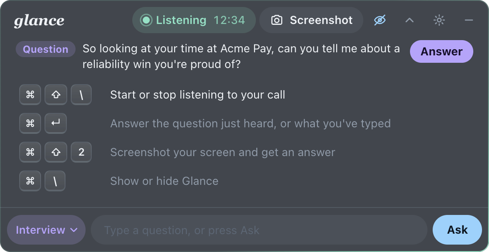
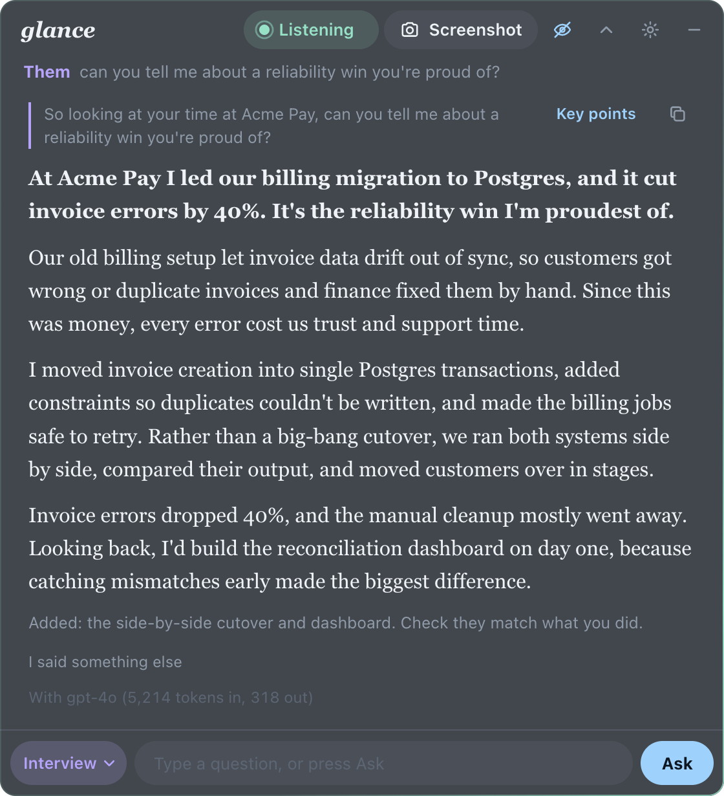
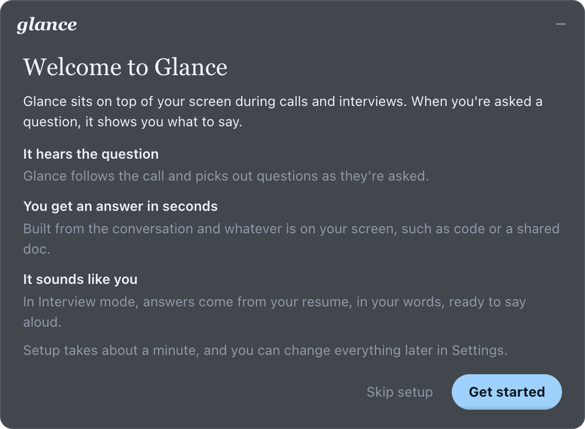
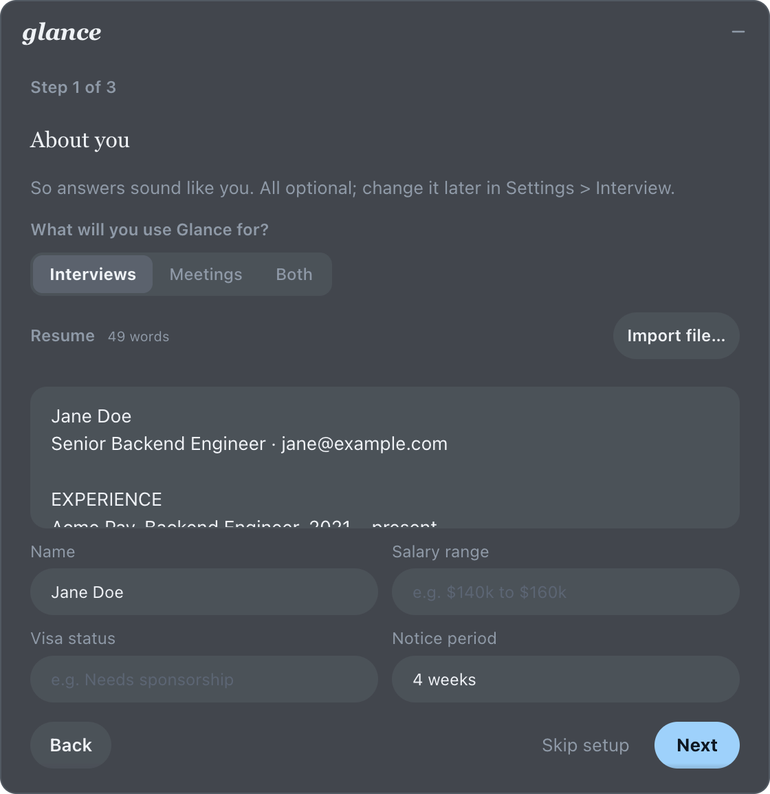
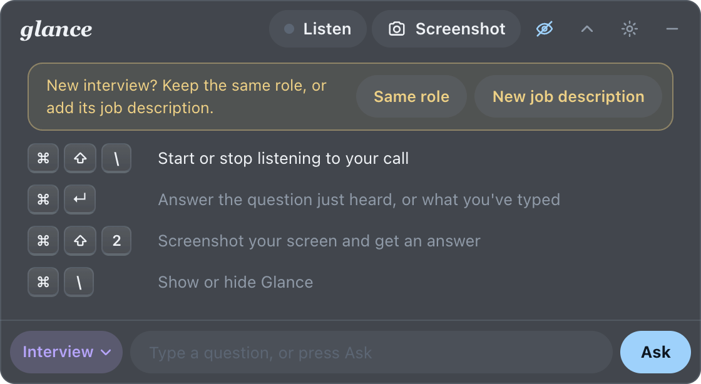
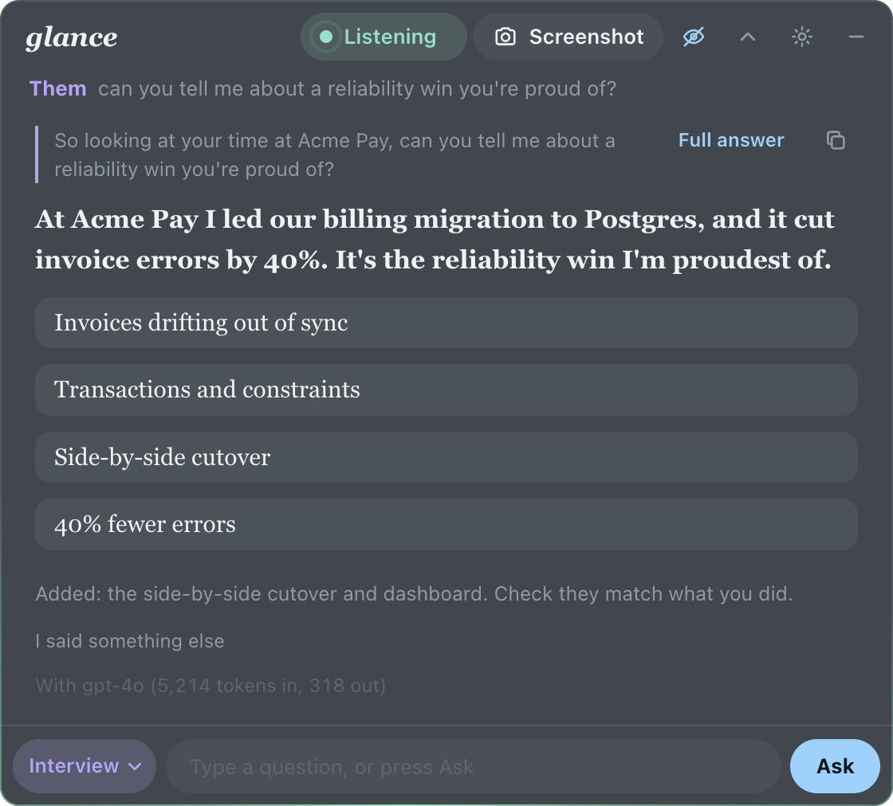
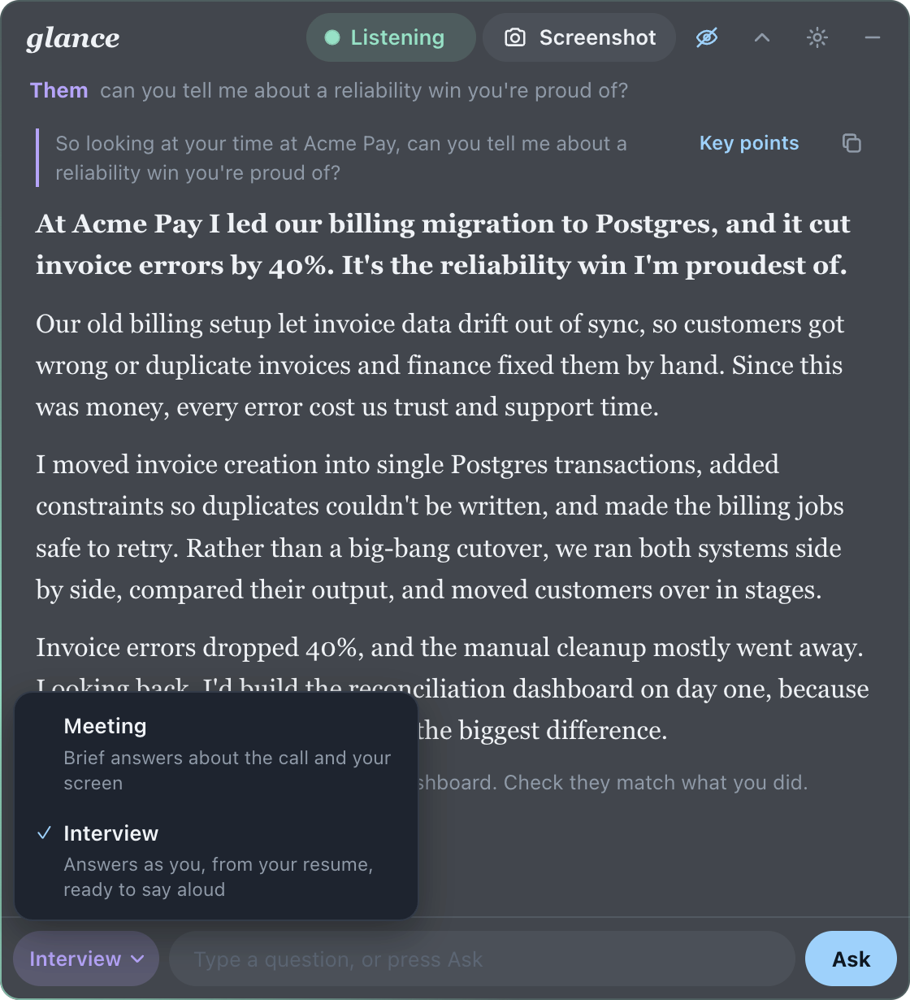
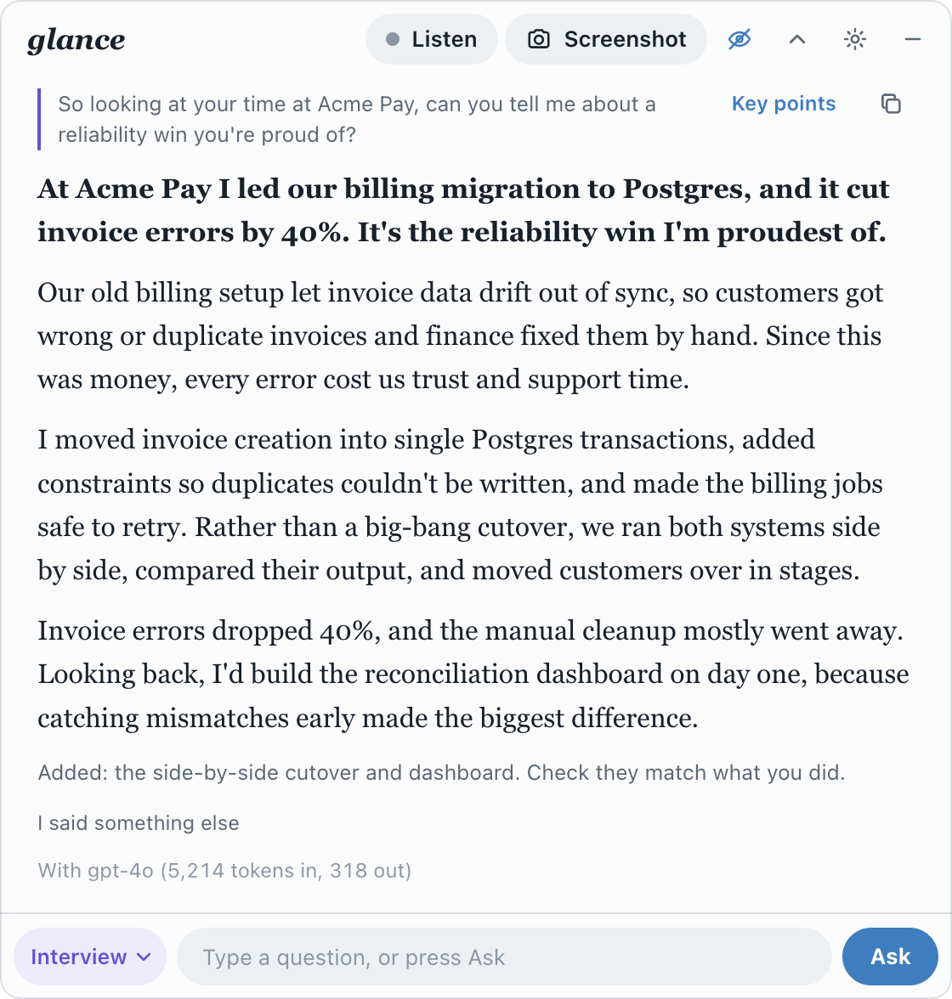
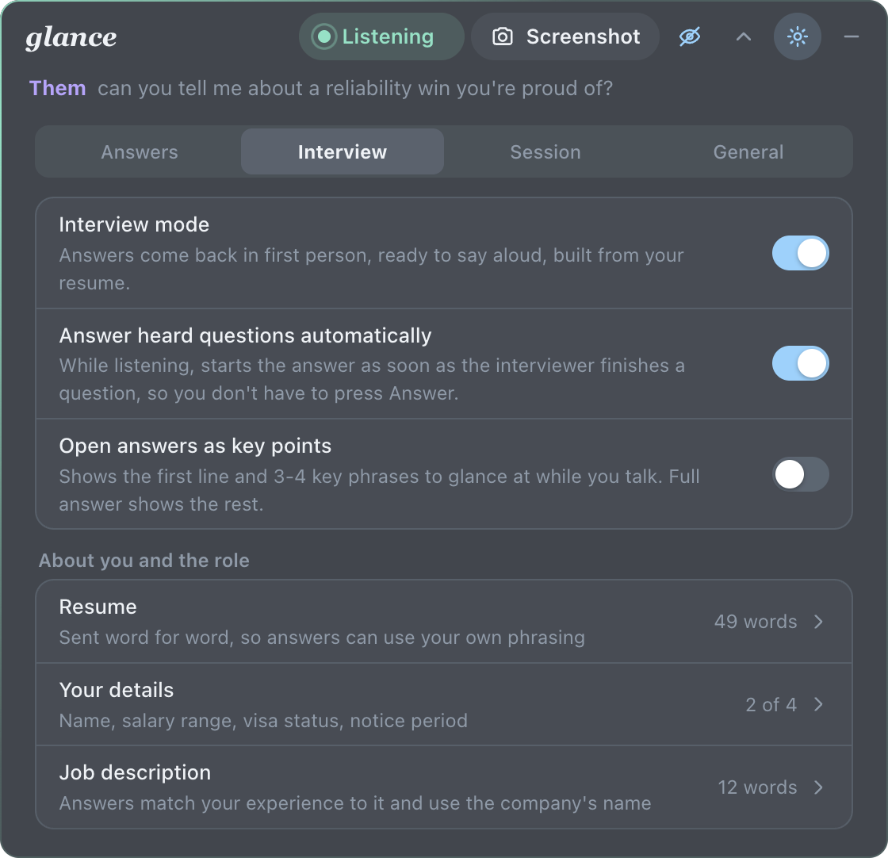
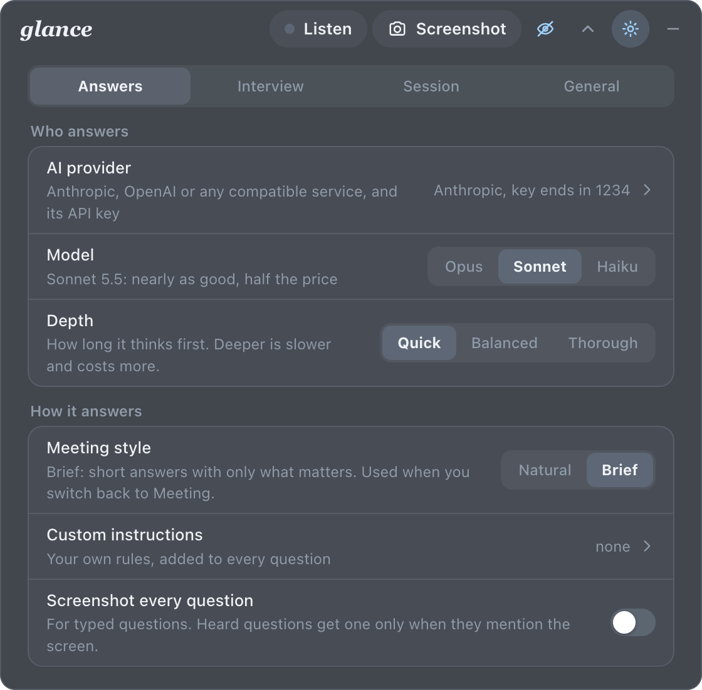

# Glance

A macOS overlay for calls and interviews. Glance listens to the other side of the call, picks out the questions, and shows you what to say, built from the conversation, your screen, and (for interviews) your own résumé. It works with Claude or any OpenAI-compatible model, and it can save meeting notes.

<p align="center">
  
  
</p>

## Contents

- [Features](#features)
- [Screenshots](#screenshots)
- [Download](#download)
- [Requirements](#requirements)
- [Build from source](#build-from-source)
- [Using Glance](#using-glance)
- [Interview mode](#interview-mode)
- [Settings](#settings)
- [AI providers](#ai-providers)
- [Privacy and data](#privacy-and-data)
- [Screen sharing: what hiding does and doesn't do](#screen-sharing-what-hiding-does-and-doesnt-do)
- [How it works](#how-it-works)
- [Development](#development)
- [Troubleshooting](#troubleshooting)
- [Uninstall](#uninstall)

## Features

- **Hears the question.** Glance transcribes the Mac's audio (the other side of a Zoom, Meet or Teams call) on your machine with Whisper and detects questions as they're asked. A question split by pauses is joined back together, lead-in included ("So looking at your time at Acme Pay, can you tell me about…").
- **Answers in seconds.** Press **Answer** (⌘↵), or in Interview mode let Glance answer on its own once the interviewer finishes. If you press Answer while they're still talking, Glance waits for the rest of the question.
- **Sounds like you.** Interview mode answers in the first person, as natural speech, using your résumé as a case study: real roles, projects and numbers, no placeholders. A short note lists anything Glance added so you can check it.
- **Glanceable.** Each long interview answer carries 3 or 4 key phrases. Switch an answer to **Key points** to see just the opening line and the phrases while you talk.
- **Keeps up with you.** If you said something different from the suggestion, press **I said something else** and type a few words; follow-ups build on what you actually said.
- **Sees your screen.** Screenshot a coding problem, an error or a shared doc and get an answer (⌘⇧2).
- **Any model.** Anthropic (Opus, Sonnet, Haiku) or any OpenAI-compatible API: OpenAI, Google Gemini, OpenRouter, Groq, Mistral, or a local Ollama or LM Studio.
- **Meeting notes.** Save a Markdown summary with decisions, action items, the transcript and every question asked.
- **Stays out of the way.** A small always-on-top panel that sizes itself to its content, can hide from screen sharing, and follows macOS light and dark mode.

## Screenshots

| | |
| --- | --- |
|  |  |
| **First launch.** A one-minute setup. | **About you.** Your résumé and details, imported or pasted. |
|  |  |
| **Each new interview.** Keep the same role or add its job description. | **Key points.** The opening line and the beats of the answer. |
|  |  |
| **Answer mode.** Meeting or Interview, one click away. | **Light mode.** Follows macOS. |
|  |  |
| **Settings › Interview.** Interview mode, auto-answer, key points, résumé. | **Settings › Answers.** Provider, model, depth and style. |

The screenshots use a made-up profile (Jane Doe at Acme Pay) and are regenerated with `node scripts/screenshots.mjs`.

## Download

1. Download the latest **Glance-…-arm64.dmg** from [Releases](https://github.com/Jchinonso/glance/releases) (Apple Silicon Macs).
2. Open it and drag **Glance** onto **Applications**.
3. Open Glance from Applications. The app isn't notarized by Apple, so the first time macOS says it can't verify the developer: **right-click Glance › Open › Open**, or go to **System Settings › Privacy & Security** and click **Open Anyway**. After that it opens normally.
4. Follow the setup, and grant **Screen & System Audio Recording** when macOS asks (then quit and reopen Glance).

Nothing else to install: the speech engine (whisper.cpp, with GPU acceleration through Metal) and its models are inside the app, which is why the download is about 700 MB. Version 1.0.0 also needed `brew install whisper-cpp`; 1.1.0 and later don't.

## Requirements

- A Mac with Apple Silicon (the build targets `darwin-arm64`).
- To build from source: [Homebrew](https://brew.sh) and Node.js 20 or later. The downloaded app needs neither.
- An API key for Anthropic or an OpenAI-compatible service, or a local model server (Ollama, LM Studio) that needs no key.

## Build from source

```sh
# 1. The transcription engine; the build copies it into the app (vendor/whisper)
brew install whisper-cpp

# 2. The speech models (not in git)
mkdir -p models
curl -L -o models/ggml-base.en.bin  https://huggingface.co/ggerganov/whisper.cpp/resolve/main/ggml-base.en.bin
curl -L -o models/ggml-small.en.bin https://huggingface.co/ggerganov/whisper.cpp/resolve/main/ggml-small.en.bin

# 3. Dependencies, then build the app (bundles whisper.cpp, then packages and signs)
npm install
npm run package

# 4. Open it
npm start   # opens dist/Glance-darwin-arm64/Glance.app

# Optional: a DMG for sharing, at dist/Glance-<version>-arm64.dmg
npm run dmg
```

On first launch Glance walks you through setup: an API key (only if none is saved), what you'll use it for, your résumé and details, and, for interviews, the job description. Everything can be changed later in Settings.

macOS asks for **Screen & System Audio Recording** permission the first time you listen or take a screenshot. Grant it to Glance, then quit and reopen the app.

`npm run dev` runs from source, but macOS won't grant it screen recording, so screenshots only work in the packaged app. Quit Glance before running `npm run package` again.

## Using Glance

1. When the call starts, press **Listen** (⌘⇧\\). The timer shows how long Glance has been listening.
2. When the other side asks a question, it appears under the bar with a **Question** tag.
3. Press **Answer** (⌘↵), or in Interview mode wait a moment: Glance answers on its own once they finish.
4. Type your own question in the box at any time, or take a screenshot (⌘⇧2) to ask about what's on screen.

| Default shortcut | Action |
| --- | --- |
| ⌘⇧\\ | Start or stop listening |
| ⌘↵ | Answer the question just heard, or what you've typed |
| ⌘⇧2 | Screenshot and answer |
| ⌘⇧1 | Add a screenshot without asking (collect several first) |
| ⌘\\ | Show or hide Glance |
| ⌘⇧H | Hide from screen sharing (on or off) |
| ⌘ + arrows | Move the window |

Shortcuts work from any app and can be changed in **Settings › General › Shortcuts**. The menu bar icon shows or hides the window; right-click it for more. Esc closes whatever panel is open.

Answers stay at the top while they stream in. Older answers stay in the pager (‹ 1 of 3 ›). An answer cut short by **Stop**, a new question or a typed one is marked "Stopped before the end". Each answer shows its estimated cost.

**Notes.** **Settings › Session › Save notes** writes a Markdown file to `~/Documents/Glance/` with a summary, decisions, action items, the transcript and every question and answer.

## Interview mode

Pick **Interview** from the mode menu beside the question box (or **Settings › Interview › Interview mode**). **Meeting** is the everyday mode.

- **Your résumé and the job description.** Import a PDF, Word, RTF or text file, or paste. Both are sent word for word with every question (up to 20,000 characters each), never compressed, so answers can use your own phrasing. Check imported PDF text: PDFs can merge lines or drop bullets.
- **Your details.** Name, salary expectation, visa status and notice period, used when an interviewer asks.
- **Answers.** First person, spoken prose: a bold opening line, two to four short paragraphs, then an optional note. Stories come from your real roles and projects; added specifics stay modest and are listed in the note. Glance answers honestly when you lack an experience, and never volunteers salary, visa or weaknesses unless asked. Technical, behavioral, system design, coding, HR, case and product questions each get a fitting shape.
- **Auto-answer.** While listening, Glance answers a heard question as soon as the interviewer finishes. It never interrupts an answer you asked for or a question you're typing, and if the interviewer carries on after a long pause, the whole question is answered again. Turn it off in **Settings › Interview › Answer heard questions automatically**.
- **Key points.** **Key points** on an answer shows the opening line and 3 or 4 phrases; **Full answer** shows the rest. To open every answer that way, turn on **Settings › Interview › Open answers as key points**.
- **I said something else.** Type what you actually said under an answer; later questions build on that, not the suggestion.
- **New interview?** When you start listening in Interview mode, Glance asks whether it's the same role or a new job description (again after 30 minutes, or after Clear session).

## Settings

The gear opens four tabs. Panels opened from Settings have a Back button that returns to the same tab.

- **Answers:** AI provider and key, model (Opus, Sonnet or Haiku on Anthropic), depth (Quick, Balanced, Thorough), meeting style (Natural or Brief), custom instructions (compressed automatically when saved), and whether typed questions include a screenshot.
- **Interview:** Interview mode, auto-answer, key points, résumé, your details, job description, and a warning when Glance would show in a screen share.
- **Session:** spending so far, the transcript, Save notes, Clear session.
- **General:** Accurate or Fast transcription, words to recognize (names and terms the transcriber should expect), hide from screen sharing, shortcuts, show the welcome again, and Delete all Glance data.

## AI providers

| Provider | Setup | Cost shown |
| --- | --- | --- |
| Anthropic | API key from [console.anthropic.com](https://console.anthropic.com) | Yes, at list prices |
| OpenAI, Gemini, OpenRouter, Groq, Mistral… | Base URL, model name and API key | Tokens only |
| Ollama or LM Studio (local) | Base URL such as `http://localhost:11434/v1` and model name; no key | Tokens only |

On Anthropic, Glance caches its instructions between questions (repeats cost a tenth), retries without the server-side refusal fallback if your account doesn't have it, and uses Opus to compress custom instructions. Text-only models can't read screenshots; Glance says so and suggests turning screenshots off.

## Privacy and data

- **Audio stays on your Mac.** Transcription runs locally with Whisper. Only text (and screenshots you take or allow) is sent to your AI provider.
- **The microphone is never recorded.** Glance hears only the Mac's audio, the other side of the call.
- **Keys** are stored in the macOS login keychain, not in files.
- **Settings** live in `~/Library/Application Support/glance/config.json`, **logs** in `~/Library/Logs/Glance/glance.log`, **notes** in `~/Documents/Glance/`.
- Glance treats the transcript, screen text, résumé and job description as data, not instructions.
- **Settings › General › Delete all Glance data** removes all of the above in one step (see [Uninstall](#uninstall)).

## Screen sharing: what hiding does and doesn't do

With **Hide from screen sharing** on (the eye icon, ⌘⇧H), macOS leaves Glance out of screen captures and recordings, including Zoom, Meet and Teams screen shares. Glance keeps itself out of its own screenshots either way.

It does **not** hide Glance from a camera pointed at your screen, from interview tools that lock down the browser or watch the camera, or from an interviewer noticing you reading. Many companies don't allow outside help during interviews; check the rules before you use it.

## How it works

```
Mac audio ──► speech detection ──► Whisper (whisper-server, kept loaded) ──► transcript
                                                                               │
                                     question detection (joins split pieces) ◄─┘
                                                  │
  résumé, job description, details, screenshots ──┼──► prompt ──► AI provider ──► streamed answer
                                                  │
                         earlier answers (or what you said instead)
```

- `src/main.js`: window, shortcuts, screenshots, keychain, settings, notes, logging, the test mode.
- `src/audio.js`: system audio capture (audiotee), speech detection, Whisper transcription. `whisper-server` keeps the model loaded and restarts if it dies. The app runs its own bundled copy of whisper.cpp, falling back to Homebrew's (for `npm run dev`).
- `scripts/bundle-whisper.sh`: copies `whisper-server`, `whisper-cli`, their libraries and ggml's compute backends (Metal, CPU, BLAS) from Homebrew into `vendor/whisper`, rewrites their library paths to stay inside the app, and signs them. Licenses are included in `vendor/whisper/licenses`.
- `src/assistant.js`: prompts and features (answers, Interview mode, instruction compression, notes), independent of any vendor.
- `src/providers.js`: Anthropic and OpenAI-compatible adapters behind one interface. Adding a provider means adding one adapter.
- `src/compress.js`: mechanical compression of the transcript and earlier answers sent with every question; numbers, code, quotes and negations are never touched.
- `src/resume.js`: résumé and job description import (PDFKit and `textutil`, built into macOS).
- `src/ui/`: the interface. `app.js` (window logic), `questions.js` (question detection and joining), `markdown.js` and `highlight.js` (answer rendering), `onboarding.js`, `hints.js`.

## Development

```sh
npm test                       # unit tests and the UI click-through
GLANCE_SKIP_UI=1 npm test      # skip the UI tests
node scripts/screenshots.mjs   # regenerate docs/images/
ANTHROPIC_API_KEY=… node test/interview-eval.js claude-sonnet-5-5   # real-API interview check
```

- **UI tests** (`test/ui.test.js`) launch the real app in test mode and drive it over the DevTools protocol: setup, every Settings tab and form, the mode menu, answers, key points, "I said something else", stopping, waiting for a question to finish, and auto-answer. Test mode (`GLANCE_TEST_DIR=<folder>`) uses its own settings folder, never touches the keychain, registers no global shortcuts and keeps its window invisible. A fake OpenAI-compatible server answers.
- **The interview eval** (`test/interview-eval.js`) asks 21 sample interview questions against a real model and checks shape, placeholders, labels, length, key phrases and consistency. `EVAL_ONLY="salary|visa"` runs a subset; `EVAL_PROVIDER=openai EVAL_BASE_URL=…` targets another vendor. Read the answers too: checks can't judge quality.
- **Roadmap:** see [PLAN.md](PLAN.md).

## Troubleshooting

- **"Glance can't see your screen."** Turn Glance on in System Settings › Privacy & Security › Screen & System Audio Recording, then quit and reopen it.
- **Listening shows nothing.** Check the same permission. Building from source: make sure `brew install whisper-cpp` ran before `npm run package` and the models are in `models/`.
- **Names or jargon are misheard.** Add them under Settings › General › Words to recognize. Accurate transcription (the default) uses the larger model.
- **A shortcut doesn't work.** Another app may own it; Glance says which at startup. Change it in Settings › General › Shortcuts.
- **Answers fail.** The message says why (key rejected, out of credit, model not found, rate limited). Check Settings › Answers › AI provider.

## Uninstall

Dragging an app to the Trash doesn't tell it anything, so on macOS an app's keys and settings stay behind unless you remove them. Glance keeps your API keys and résumé, so remove them first:

1. Open Glance, then **Settings › General › Delete all Glance data**. It lists what it removes and asks you to confirm:
   - your API keys, from the macOS keychain;
   - settings, résumé, job description and your details (`~/Library/Application Support/Glance`);
   - logs (`~/Library/Logs/Glance`);
   - optionally, your saved meeting notes (`~/Documents/Glance`), moved to the Trash.

   Glance then quits.
2. Drag **Glance** from Applications to the Trash.
3. Optional: remove Glance from **System Settings › Privacy & Security › Screen & System Audio Recording**.

Already deleted the app? Remove the leftovers by hand:

```sh
security delete-generic-password -s com.glance.overlay.api-key -a glance   # Anthropic key
security delete-generic-password -s com.glance.overlay.api-key -a openai   # OpenAI-compatible key, if set
rm -rf ~/Library/Application\ Support/Glance ~/Library/Logs/Glance
# Saved notes, if you don't want them: ~/Documents/Glance
```

